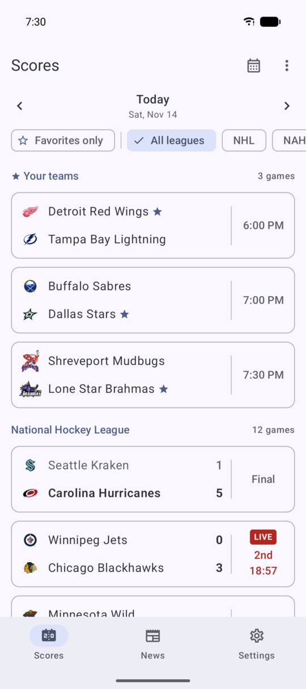
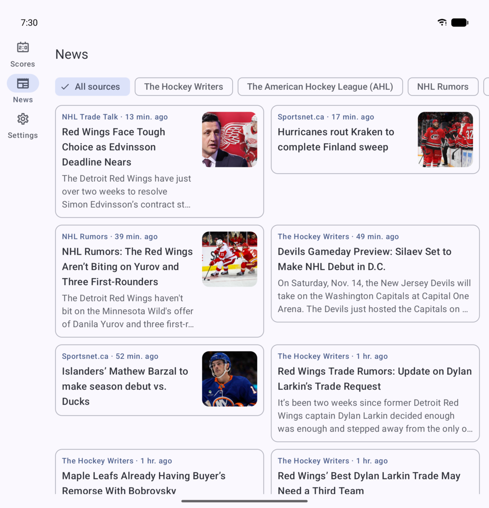
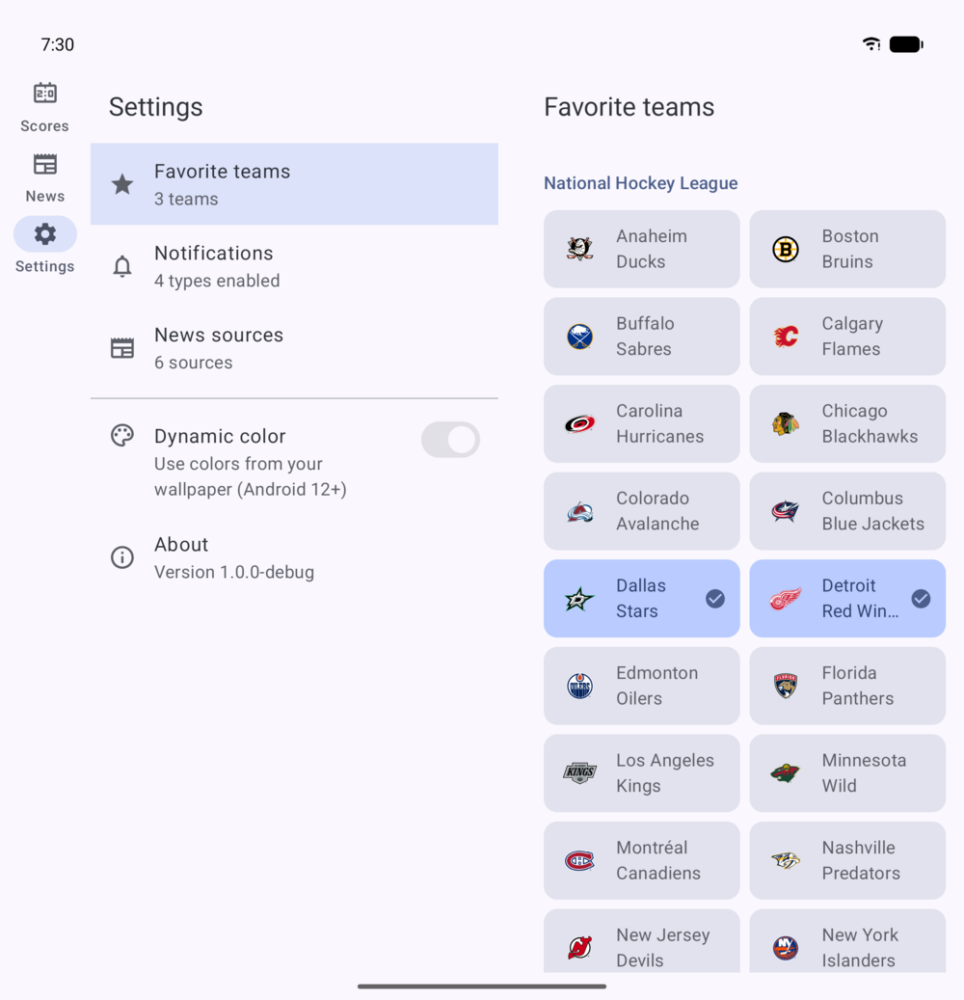

# Zamboni

Material 3 Android app (`io.rbware.zamboni`) built with Jetpack Compose, with adaptive layouts for phones, foldables and tablets.
Version 1.0.0. Scores for the NHL and NAHL, hockey news from several feeds, and favorite teams.

## Screenshots

### Phone

| Scores | Game details | News | About |
| :---: | :---: | :---: | :---: |
|  |  |  |  |

### Foldable (unfolded)

On a wide screen the scores fill the screen in two columns; opening a game slides its details
in beside the list (closed with the X or back). Settings show the section being edited beside
the list.

| Scores | Game details |
| :---: | :---: |
|  |  |

| News | Settings |
| :---: | :---: |
|  |  |

## Stack
- Kotlin 2.3, AGP 8.13, Gradle 8.13, JDK 17 target
- Jetpack Compose (BOM 2026.06.01), Material 3 with dynamic color
- `material3-adaptive` (list/detail pane scaffold for Settings) and `material3-adaptive-navigation-suite`
- minSdk 26, targetSdk / compileSdk 36

## Layout
```
app/src/main/java/io/rbware/zamboni/
|-- ZamboniApplication.kt        # creates the AppContainer, image loader, logo prefetch
|-- MainActivity.kt              # splash, then onboarding (first run) or main UI
|-- di/AppContainer.kt           # manual DI: HTTP client, APIs, repositories
|-- data/
|   |-- model/                   # Game, Team, NewsArticle, ...
|   |-- remote/                  # NHL, hockeynerd.com and Gamesheet APIs (Retrofit) and response models
|   |-- scores/                  # schedule + game details repositories and mappers
|   |-- news/                    # RSS sources, parser and repository
|   |-- logos/                   # NHL logo URLs and offline prefetch
|   |-- preferences/             # DataStore-backed user choices + migrations
|   `-- teams/                   # team list for favorites (placeholder data)
`-- ui/
    |-- ZamboniApp.kt            # NavigationSuiteScaffold: bottom bar, rail or drawer by window size
    |-- onboarding/              # first-run flow: welcome, teams, notifications, news
    |-- preferences/             # pickers shared by onboarding and Settings
    |-- scores/                  # Scores tab: date, filters, game list and game detail
    |-- news/                    # News tab: articles from the chosen RSS sources
    |-- settings/                # Settings tab: onboarding choices and About
    `-- theme/                   # color scheme, typography, ZamboniTheme
```
Also: `docs/screenshots/` (README images) and `tools/generate_launcher_icon.py` (draws the
launcher icon vectors).

## Adding a news source
Add one line to `data/news/NewsSources.kt`:
```kotlin
NewsSource(id = "example", name = "Example Hockey", feedUrl = "https://example.com/feed/"),
```
- `id` is saved in user preferences: keep it unique and never change it after release.
- The feed must be RSS 2.0 served over https.
- It then appears in onboarding and Settings automatically.

## Scores data
Scores and game details come from the public NHL web API (`api-web.nhle.com`, no key
needed). If a request to it fails, the same request is retried against hockeynerd.com
(`FallbackScoresRepository`). Both use the NHL's game IDs, so a game listed by one source can
be opened through the other. Season records come from the NHL standings, and team colors
(which the NHL API doesn't provide) are a fixed table in `NhlTeamColors`.

NAHL scores and teams come from the Gamesheet stats gateway (`gateway.gamesheet.io`), which
needs a partner API key. Put it in `local.properties` (not committed):

```
gamesheet.apiKey=YOUR_KEY
```

Without it the NAHL is left out. Notes on the Gamesheet data:
- Games, scores, goal scorers and team stats come from `stats/unifiedschedule` (the data
  behind the nahl.com game center), one request per season for a day, or per game for details.
- Seasons are looked up through one club's `myclub` page (Lone Star Brahmas, `4-605`).
  Regular season, exhibition and playoff seasons overlap, so a day may query several.
- Goal times are given as time left on the clock; they are converted to time elapsed assuming
  20-minute periods and 5-minute overtime.
- No assists, goal strengths or player photos are available.
- Live games show as "In progress": scores seem to be entered only after the game, so a live
  score is only shown if one has been entered.
- Team IDs are built from team names (e.g. `nahl-lone-star-brahmas`), since Gamesheet's
  numeric team IDs change every season. A renamed team would need a favorites migration.

## Still to do
- Teams: replace the placeholder team list with data from an API.
- AHL: turned off (`PlaceholderHockeyData.AHL_ENABLED`) until there is a scores source. The AHL
  news feed is unaffected.
- Notifications: preferences are stored, but nothing is delivered yet.

## Build
```sh
./gradlew assembleDebug        # debug build installs as io.rbware.zamboni.debug
./gradlew testDebugUnitTest
```
