# Zamboni

Material 3 Android app (`io.rbware.zamboni`) built with Jetpack Compose, with adaptive layouts for phones, foldables and tablets.
Version 2.2.1. Scores for the NHL, AHL and NAHL, hockey news from several feeds, a Social feed of
Mastodon accounts and YouTube channels, game and news alerts, Live Updates and team radio for
your favorite teams.

## Features
- **Leagues**: follow only the leagues you care about (NHL by default), chosen in onboarding
  before favorite teams and changed any time in Settings. Turned-off leagues disappear from
  scores, teams, alerts and Live Updates; at least one stays on.
- **Scores**: NHL, AHL and NAHL games by day, with favorites first and league filters. Live game
  clocks count down every second between updates.
- **Game details**: scoring by period, team stats, and "Where to watch": national and local
  TV and streaming broadcasts, and each team's radio broadcast to listen to in the app.
- **Team radio**: keeps playing in the background with the usual media controls in the
  notification and on the lock screen. A now-playing bar above the navigation pauses, resumes
  or stops it from any tab, and opens the game when tapped.
- **Alerts**: game start, goals, final score and breaking news for your favorite teams.
- **Live Updates** (Android 16+): while a favorite team plays, the score shows as a chip in the
  status bar and a pinned notification shows the score, period and clock, kept up to date
  every few seconds.
- **Mute this game**: in a favorite team's game details, for when you're watching anyway. No
  alerts and no Live Update for that one game; other games aren't affected.
- **News**: articles from the RSS feeds you choose.
- **Social**: posts from Mastodon accounts (including mirrors of team and media accounts) and
  videos from YouTube channels. Tap a team to turn on all of its accounts at once, in
  Settings, onboarding or the empty Social tab.

## Screenshots

### Phone

| Scores | Game details | News |
| :---: | :---: | :---: |
|  | 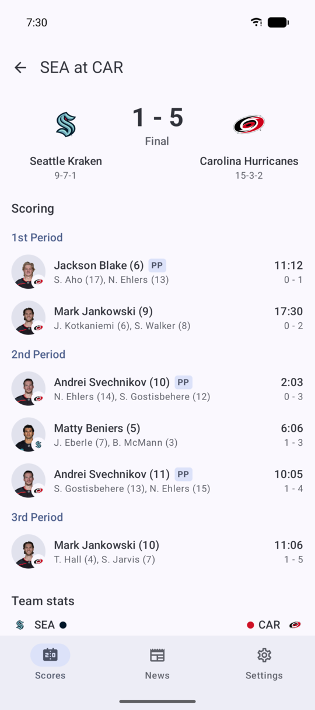 | 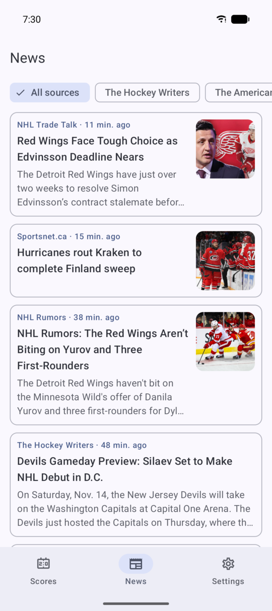 |

| Social | Settings | About |
| :---: | :---: | :---: |
| 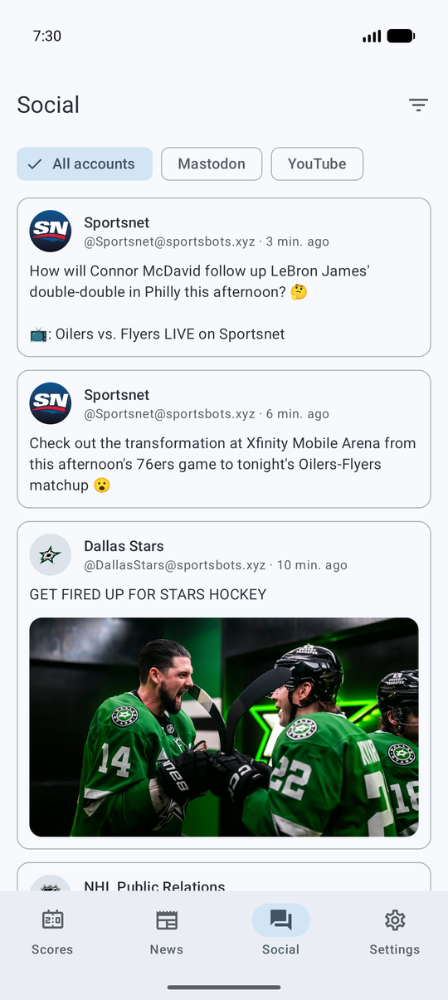 | 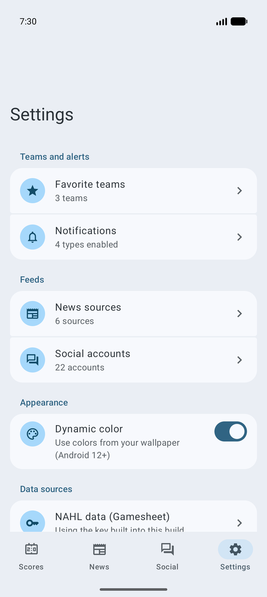 | 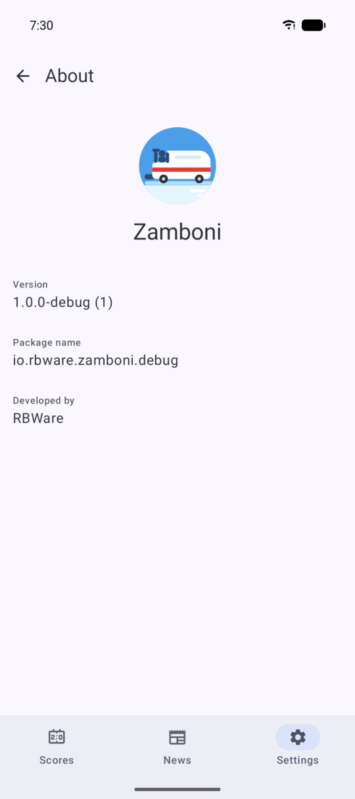 |

### Live games

| Mute this game | Where to watch and radio | Now-playing bar |
| :---: | :---: | :---: |
| 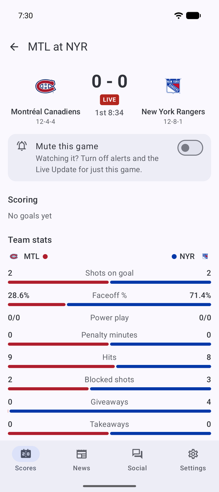 | 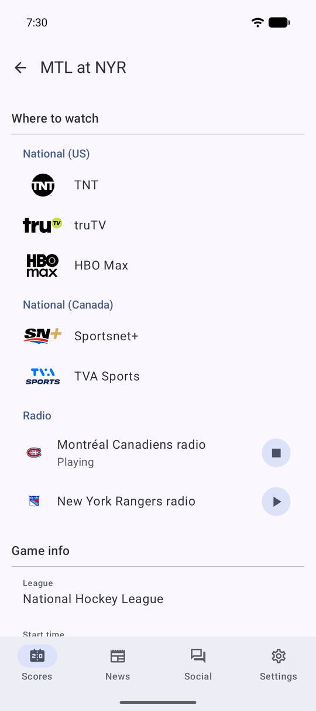 | 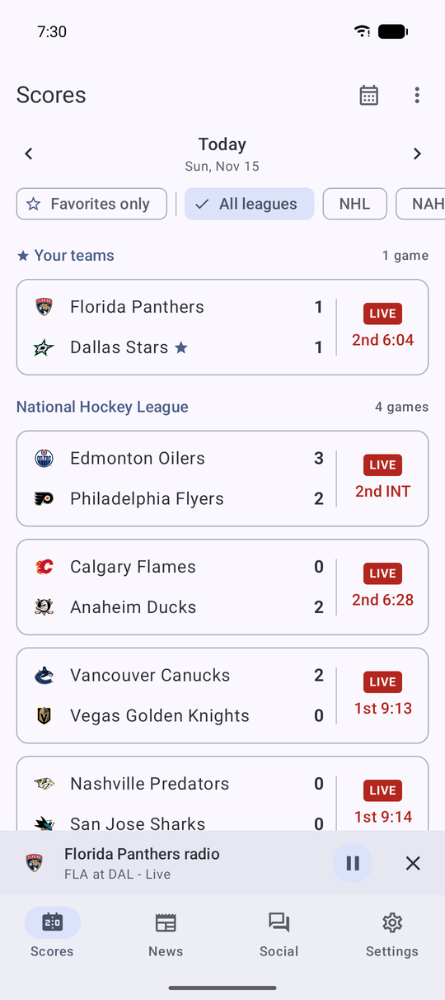 |

<p align="center">
  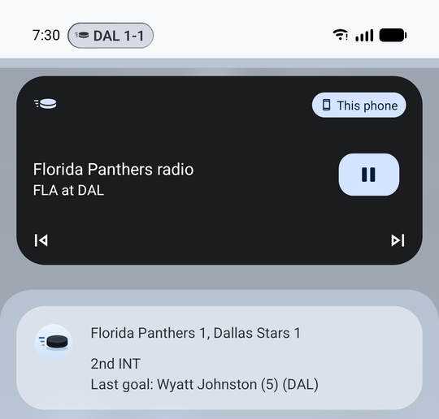<br>
  Live Update: the score chip in the status bar, the radio's media player and the Live Update
  notification.
</p>

### Foldable (unfolded)

On a wide screen the scores, news and social feeds fill the screen in two columns; opening a
game slides its details in beside the list (closed with the X or back). Settings show the
section being edited beside the list.

| Scores | Game details |
| :---: | :---: |
| 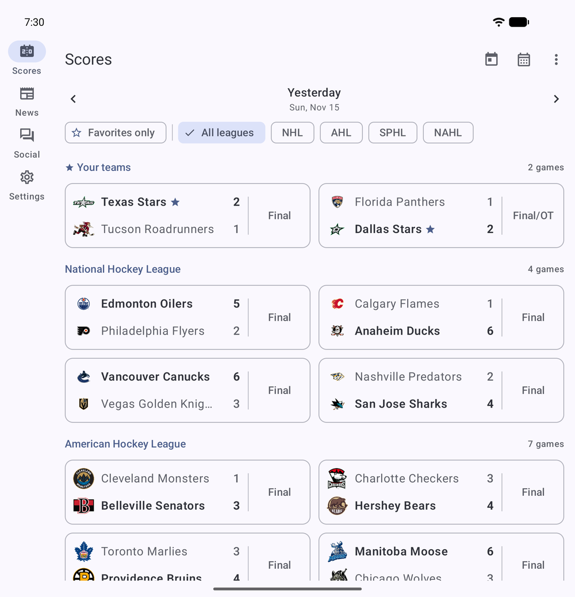 | 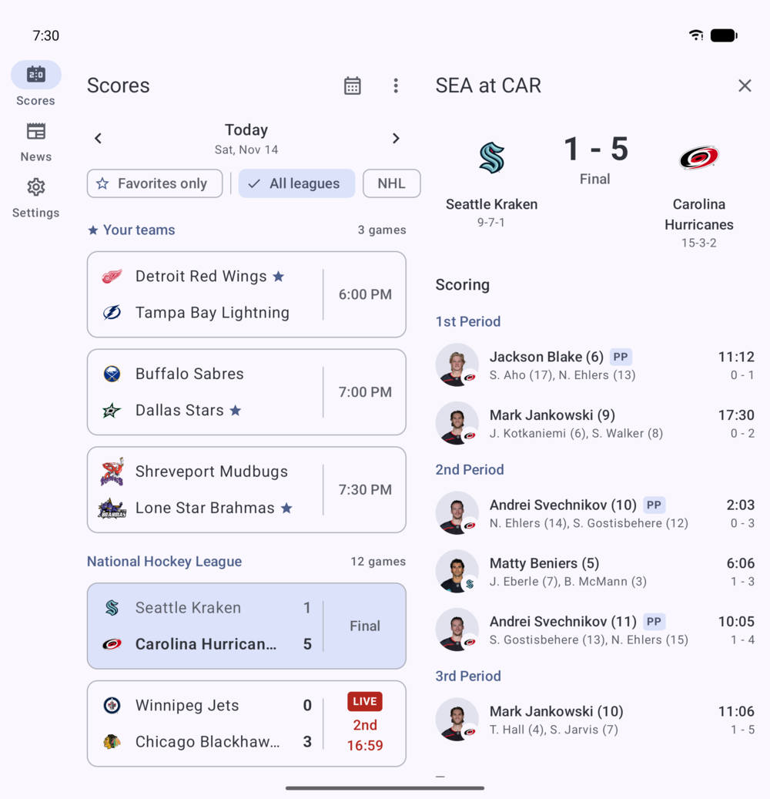 |

| News | Social |
| :---: | :---: |
|  | 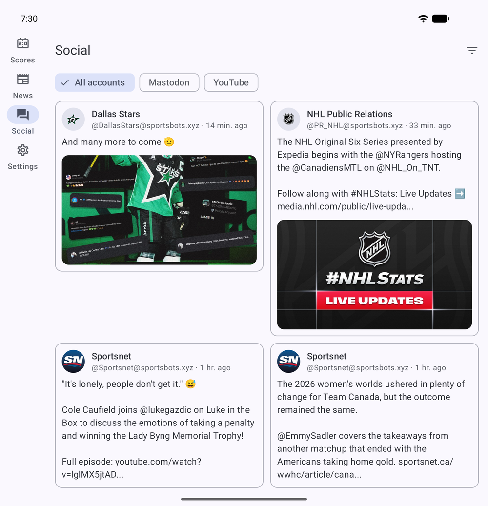 |

| Settings: favorite teams | Settings: social accounts |
| :---: | :---: |
|  | 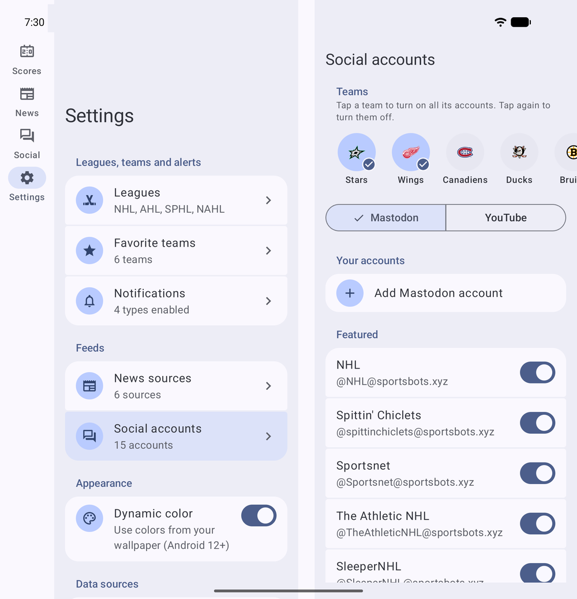 |

| Live game: Mute this game | Where to watch and radio |
| :---: | :---: |
| 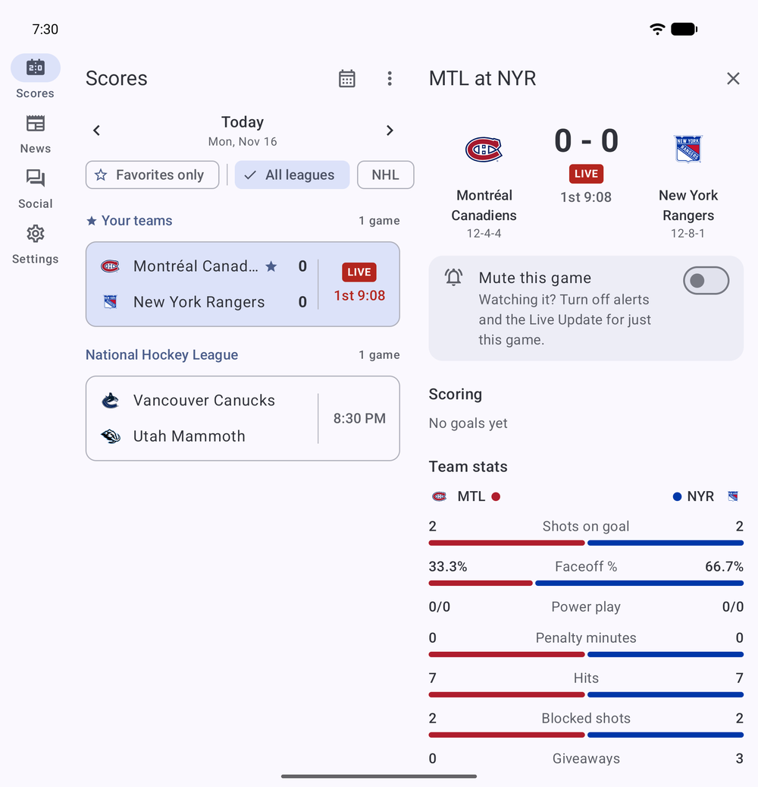 | 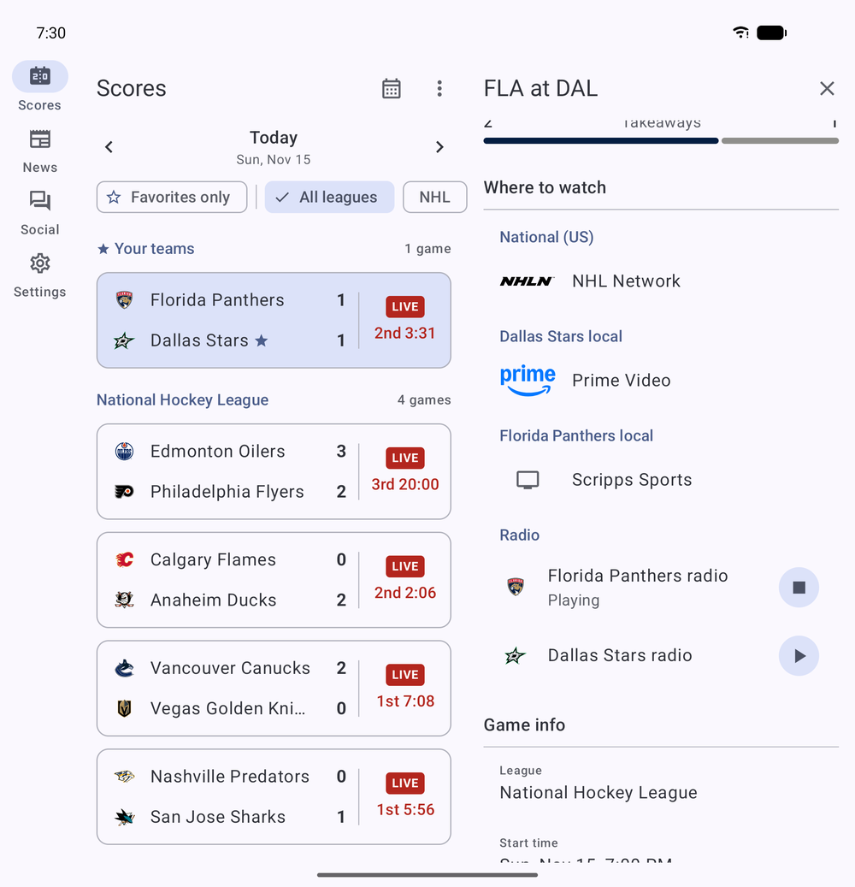 |

| Now-playing bar |
| :---: |
| 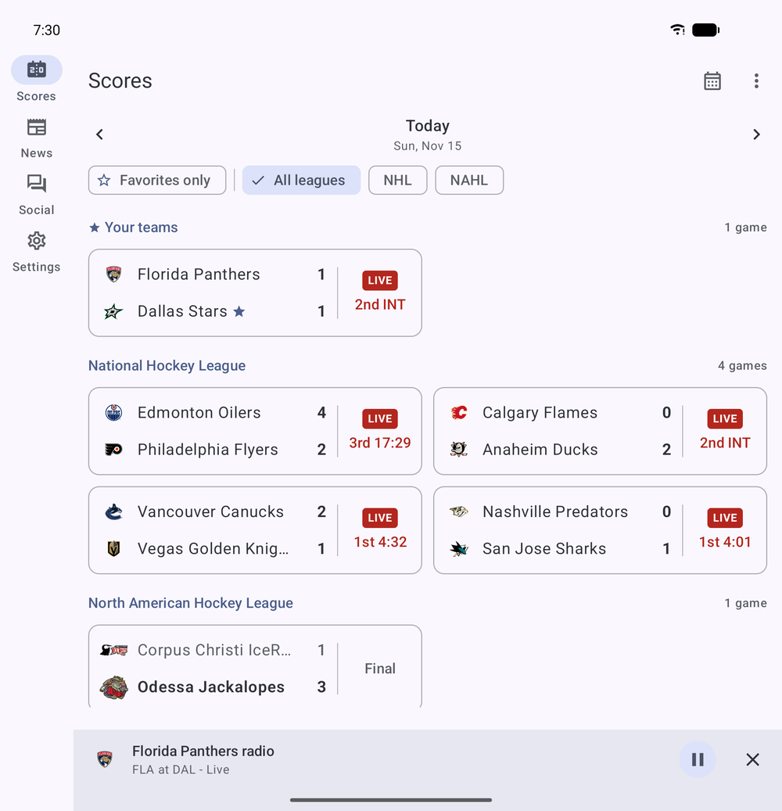 |

## Stack
- Kotlin 2.3, AGP 8.13, Gradle 8.13, JDK 17 target
- Jetpack Compose (BOM 2026.06.01), Material 3 with dynamic color
- `material3-adaptive` (list/detail pane scaffold for Settings) and `material3-adaptive-navigation-suite`
- Media3 (ExoPlayer with HLS, MediaSession) for team radio
- minSdk 26, targetSdk / compileSdk 36

## Layout
```
app/src/main/java/io/rbware/zamboni/
|-- ZamboniApplication.kt        # creates the AppContainer, image loader, logo prefetch
|-- MainActivity.kt              # splash, then onboarding (first run) or main UI
|-- di/AppContainer.kt           # manual DI: HTTP client, APIs, repositories
|-- data/
|   |-- model/                   # Game, Team, NewsArticle, ...
|   |-- remote/                  # NHL, hockeynerd.com, HockeyTech and Gamesheet APIs (Retrofit) and response models
|   |-- scores/                  # schedule + game details repositories and mappers
|   |-- news/                    # RSS sources, parser and repository
|   |-- social/                  # built-in accounts, Mastodon/ActivityPub and YouTube clients, feed
|   |-- logos/                   # NHL logo URLs and offline prefetch
|   |-- preferences/             # DataStore-backed user choices + migrations
|   `-- teams/                   # team lists for favorites (NHL placeholder data, AHL and NAHL from their APIs)
|-- notifications/               # background checks for alerts, Live Updates service, game mutes
|-- radio/                       # team radio: playback service and the UI's player controls
`-- ui/
    |-- ZamboniApp.kt            # NavigationSuiteScaffold: bottom bar, rail or drawer by window size
    |-- NowPlayingBar.kt         # radio controls shown above the navigation while it plays
    |-- onboarding/              # first-run flow: welcome, teams, notifications, news, social
    |-- preferences/             # pickers shared by onboarding and Settings
    |-- scores/                  # Scores tab: date, filters, game list and game detail
    |-- news/                    # News tab: articles from the chosen RSS sources
    |-- social/                  # Social tab: posts and videos from the chosen accounts
    |-- settings/                # Settings tab: onboarding choices, HockeyTech and Gamesheet keys, About
    `-- theme/                   # color scheme, typography, ZamboniTheme
```
Also: `docs/screenshots/` (README images).

## Adding a league
1. Add it to `Leagues.all` in `data/leagues/Leagues.kt`. The ID is saved in user preferences:
   keep it unique and never change it. It then appears in the league picker (onboarding and
   Settings) and the Scores filter.
2. Write a `ScoresRepository` for it (and a `TeamRepository` for its favorites list), with
   game and team IDs that start with the league ID and a dash (e.g. `ahl-1029321`, `ahl-bel`).
3. Register it in `AppContainer`: a `MultiLeagueScoresRepository.Source` with the league's ID,
   and its team repository in `CombinedTeamRepository`. A league that's turned off is never
   loaded, so it costs nothing until someone turns it on.
4. If its source needs a key, follow the HockeyTech or Gamesheet pattern (`ApiKeyProvider`,
   `ApiKeySection`) and show the Settings entry only while the league is on.

## Adding a news source
Add one line to `data/news/NewsSources.kt`:
```kotlin
NewsSource(id = "example", name = "Example Hockey", feedUrl = "https://example.com/feed/"),
```
- `id` is saved in user preferences: keep it unique and never change it after release.
- The feed must be RSS 2.0 served over https.
- It then appears in onboarding and Settings automatically.

## Scores data
Scores and game details come from the public NHL web API (`api-web.nhle.com`, no key
needed). If a request to it fails, the same request is retried against hockeynerd.com
(`FallbackScoresRepository`). Both use the NHL's game IDs, so a game listed by one source can
be opened through the other. Season records come from the NHL standings, and team colors
(which the NHL API doesn't provide) are a fixed table in `NhlTeamColors`.

NAHL scores and teams come from the Gamesheet stats gateway (`gateway.gamesheet.io`), which
needs a partner API key. No key ships with the app: users enter their own under
Settings > NAHL data (Gamesheet). The key is checked against Gamesheet before it is saved and
is stored on the device only. Without a key the NAHL is left out (no games, teams or filter).

AHL scores, game details and teams come from HockeyTech's LeagueStat feed
(`lscluster.hockeytech.com`), the data behind theahl.com. It needs a key; the app uses the
public one that theahl.com's own pages send. Users can enter another under
Settings > AHL data (HockeyTech), which is checked the same way as a Gamesheet key.

Notes on the HockeyTech data:
- Days around today (one game day either way) come from the `scorebar` view, which is small
  and has live status. Other days come from the season's full `schedule`, which is about 2 MB
  (150 KB gzipped), so it is kept for 30 minutes.
- Game details come from `statviewfeed` `gameSummary` (goals with assists, strengths and season
  totals, shots, power plays, penalty minutes), with the period and clock from the `gc` feed's
  `clock` tab.
- A wrong key gets HTTP 200 with the text "Invalid key.", and `gameSummary` is wrapped in
  parentheses, so responses are parsed by hand (`decodeHockeyTech`).
- Team IDs are "ahl-" plus HockeyTech's team code (e.g. `ahl-bel`). Version 1.0 had a
  placeholder AHL list with a few different codes; `AhlTeamIdMigration` renames those favorites.
- Faceoffs and hits aren't recorded in every rink, so they are left out when both read 0.

For development, debug builds can have a Gamesheet key built in from `local.properties` (not
committed):

```
gamesheet.apiKey=YOUR_KEY
```

Release builds never include it, even when `local.properties` has one. A key entered in
Settings takes priority over the built-in one.

Notes on the Gamesheet data:
- Games, scores, goal scorers and team stats come from `stats/unifiedschedule` (the data
  behind the nahl.com game center), one request per season for a day, or per game for details.
- Seasons are looked up through one club's `myclub` page (Lone Star Brahmas, `4-605`).
  Regular season, exhibition and playoff seasons overlap, so a day may query several.
- Goal times are given as time left on the clock; they are converted to time elapsed assuming
  20-minute periods and 5-minute overtime.
- No assists, goal strengths or player photos are available.
- Live games show as "In progress": scores seem to be entered only after the game, so a live
  score is only shown if one has been entered.
- Team IDs are built from team names (e.g. `nahl-lone-star-brahmas`), since Gamesheet's
  numeric team IDs change every season. A renamed team would need a favorites migration.

## Live games
- **Freshness**: the NHL API sits behind a CDN that caches scores for about 20 seconds and a
  game's details for about 10. The app reads the `Age` and `Cache-Control` headers to time each
  refresh just after a fresh copy appears, and to know how old the clock it shows is.
- **Ticking clock**: between updates the clock counts down on screen from that moment. It
  stops 30 seconds after the last update, and corrects itself (e.g. after a whistle) on the
  next one. The scores list takes newer data from an open game's details, so both agree.
- **Live Updates**: a foreground service (`LiveGameService`, type `specialUse`) runs while a
  favorite team's game is on and stops when none is. It refreshes the notification, and runs
  the regular alert check every 20 seconds so goal alerts keep pace. Android only lets it start
  while the app is on screen or from an exact alarm, so it starts when the app is opened, or at
  puck drop if "Alarms & reminders" is allowed (Settings > Notifications links to it).
  Otherwise the regular background checks show the Live Update and refresh it every couple of
  minutes.
- **Broadcasts and radio**: both come from the game's `landing` data (`tvBroadcasts` and each
  team's `radioLink`, an HLS stream). Network codes are expanded in `BroadcastNames`; unknown
  codes are shown as they are. Not every team has a radio stream for every game. AHL teams
  link to their broadcaster's web page instead (iHeartRadio, Mixlr...), which opens in the
  browser.

## Still to do
- Teams: replace the placeholder NHL team list with data from an API.
- AHL team colors: HockeyTech doesn't provide them, so AHL stat comparisons use the fallback
  colors.

## Build
```sh
./gradlew assembleDebug        # debug build installs as io.rbware.zamboni.debug
./gradlew testDebugUnitTest
```
